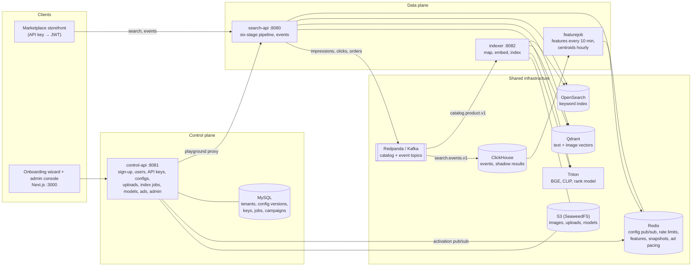
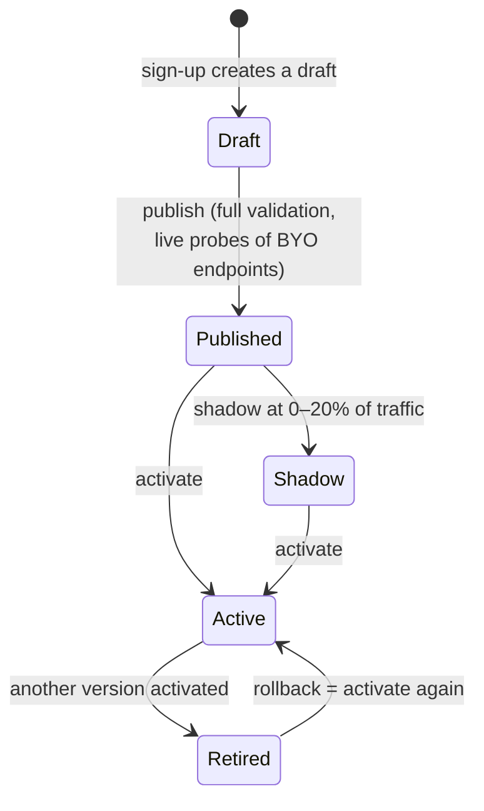
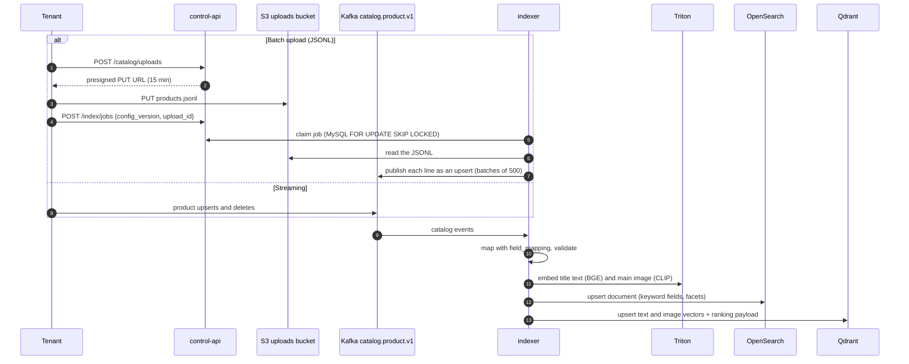
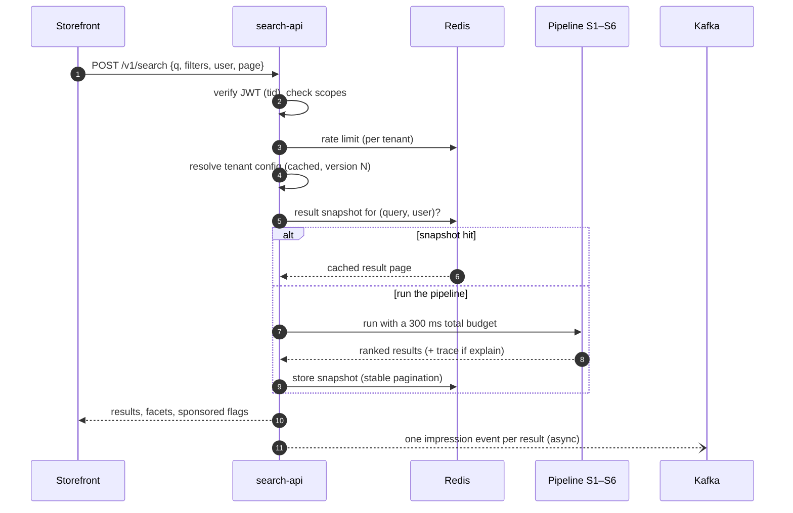
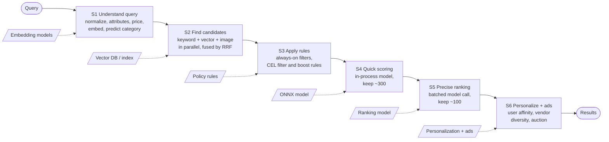
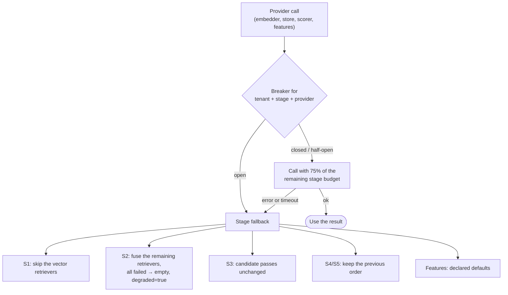
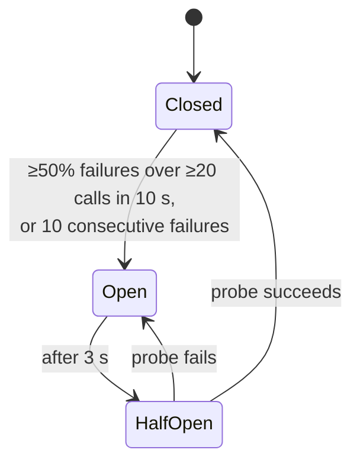
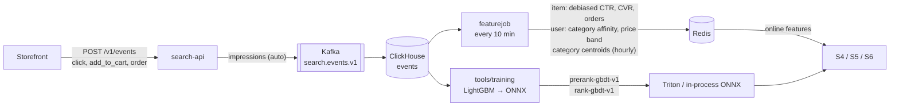
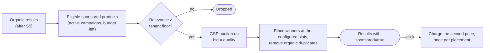

# HOW_IT_WORKS.md — The search engine, end to end

A guided tour of the whole system: what each part does, how a product becomes searchable, what
happens during one search, and how the engine learns. It links to the detailed specs instead of
repeating them: [`ARCHITECTURE.md`](ARCHITECTURE.md), [`TENANT_CONFIG.md`](TENANT_CONFIG.md),
[`DATA.md`](DATA.md), [`MODELS.md`](MODELS.md), [`API.md`](API.md), [`ONBOARDING.md`](ONBOARDING.md)
and [`RUNBOOK.md`](RUNBOOK.md).

## 1. What it is

A multi-tenant product search service for multi-vendor marketplaces. Each **tenant** (a
marketplace) gets:

- **Text search** ("red leather handbag under $100"), **image search** (upload a photo) and
  **similar items** (more like this product).
- A **six-stage pipeline** where every stage starts on a platform default and can be swapped for
  the tenant's own model, vector store or rules (**BYO**, bring your own).
- **Versioned configuration**: every change is published as an immutable version, tried in a
  playground or in shadow mode, then activated (and rolled back by activating an older one).
- **Learning from behaviour**: clicks, add-to-carts and orders feed features and trained ranking
  models.
- **Sponsored results**: vendors bid on placements, which are auctioned and blended into results.

## 2. The big picture



| Service | Role |
|---|---|
| **search-api** | Stateless and horizontally scaled. Authenticates the request, loads the tenant's active config, runs the pipeline, returns results and emits one impression event per result. Also accepts behaviour events and vendor data. |
| **control-api** | Everything that is not a search: sign-up and email verification, users and API keys, config drafts and versions, onboarding state, catalog uploads and index jobs, model and connection registration, ad campaigns, the platform admin API. Issues the JWTs (Ed25519, rotating keys) that search-api verifies through the JWKS. |
| **indexer** | Turns catalog events into searchable documents: maps each tenant's product JSON to the canonical schema, embeds titles and images, writes OpenSearch and Qdrant. Also runs the index jobs control-api queues. |
| **featurejob** | Aggregates the last 30 days of events into online features (debiased CTR, conversion, user category and price affinity) in Redis, and refreshes the category centroids used to predict a query's category. |
| **web/onboarding** | The 9-step setup wizard for tenants and the `/admin` console for platform operators. |

## 3. Tenants and isolation

Every request carries a JWT whose `tid` claim is the tenant; it is the only source of tenant
identity. Each tenant's data lives in its own index and collection (`t_{tenant}_products_v{n}`
behind an alias), so one tenant's search can never see another's products.

A slow or failing tenant cannot hurt the others:

- **Rate limits** per tenant and plan (Redis GCRA); excess requests get `429`.
- **Circuit breakers** per *(tenant, stage, provider)*: one tenant's broken endpoint trips only
  that tenant's breaker.
- **Bulkheads**: each tenant's calls to its own (BYO) endpoints share a bounded pool (32 per
  search-api by default); when it is full, calls fail fast instead of queueing.

The isolation load test (`loadtest/reports/`) hangs one tenant's ranking endpoint for 2 s and
shows the other tenant's latency does not move.

## 4. Onboarding: from sign-up to live search


Each step edits the tenant's **draft** config and is validated by the same rules as publishing
(`TENANT_CONFIG.md` §5). The important ones:

- **Catalog** maps the tenant's own product JSON to the canonical fields with JSONPath (for
  example `title` ← `$.name`, `price_minor` ← `$.price.amount_minor`). `product_id`, `title`,
  `category_path`, `price_minor`, `currency`, `vendor_id` and at least one image URL are required.
  The mapping only selects values: prices must already be integer minor units (cents).
- **Index build** publishes the draft as a version and queues an index job for the uploaded file.
- **Go live** activates the version (needs a verified email) and shows the API key once.

### Config versions



- Versions are **immutable**. Rolling back is activating an older version; nothing is edited in
  place.
- On activation control-api publishes `tenant.config.activated` on Redis pub/sub; every
  search-api drops its cached config and serves the new version within milliseconds. A 30 s
  reconcile loop catches lost messages.
- The **playground** searches any published version or the draft without activating it, always
  with the explain trace. **Shadow mode** runs a published version on a sample of real traffic
  after the response is sent and logs the comparison (overlap@10, latencies) to ClickHouse; its
  results are never shown to shoppers.

## 5. Getting products in

Two ways in, one path through the indexer:



- Lines that fail mapping or validation are counted as failed on the job and skipped; the rest
  are indexed.
- Image URLs are fetched through the egress policy (public hosts only, unless trusted), resized
  and embedded.
- Every event carries a `source_version`; OpenSearch rejects older versions, so out-of-order
  events never overwrite newer data.
- A change that alters indexed fields (mapping, embedders) builds a **new index version**
  `v{n+1}` and swaps the alias when it is complete; search keeps serving the old version until
  then.

## 6. One search, step by step



### The six stages



The dashed inputs are where a tenant can plug in its own provider.

| Stage | What it does | Default provider | Budget (text / image) |
|---|---|---|---|
| **S1** Understand query | Normalizes text; extracts colour, material, size and price phrases ("under $100" becomes a price filter); embeds the query; predicts the category from centroids (text) or the nearest images' categories (image). | `bge-small-en-v1.5` (text, 384-d), `clip-vit-b32` (image, 512-d) on Triton | 40 / 130 ms |
| **S2** Find candidates | Runs the configured retrievers in parallel with filters pushed down into the stores: `lexical_bm25` (OpenSearch), `vector_text`, `vector_image`, `vector_text_to_image` (Qdrant). Fuses the lists with Reciprocal Rank Fusion: `score = Σ wᵣ / (60 + rankᵣ)`. | Platform OpenSearch + Qdrant | 120 / 80 ms |
| **S3** Apply rules | Always-on filters (active, in stock, ships to region) are already applied in S2. CEL rules drop candidates (`filter`) or add a bounded boost (`boost`, clamped to [-1, 1]). | Built-in CEL engine | 10 / 5 ms |
| **S4** Quick scoring | Scores a few hundred candidates with a fast in-process model on features (retrieval scores, price, rating, CTR…), keeps the top 300. | `default_linear` or `prerank-gbdt-v1` (ONNX) | 15 / 10 ms |
| **S5** Precise ranking | One batched call to a heavier model; keeps the top 100. | `default_linear` or `rank-gbdt-v1` (Triton) | 40 / 25 ms |
| **S6** Personalize + ads | Adds user affinity and price-band match, limits results per vendor within a window, then auctions sponsored slots and blends them in. | Built-in | 30 / 20 ms |

Image searches use the image budgets because embedding a photo on CPU takes longer than
embedding text. Uploads are checked (≤ 10 MB, JPEG/PNG/WebP by magic bytes, ≤ 4096 px),
re-encoded and shrunk to a small JPEG before embedding.

### Explain trace

With `"explain": true` (a key with `search:debug`, or any playground search) the response lists
every stage: provider, latency, candidates in → out, and any fallback. This is the first thing to
read when a search looks wrong (`RUNBOOK.md` §2).

## 7. Staying up: budgets, fallbacks and breakers

Every stage has a time budget, and every provider call goes through `resilience.Call`. A search
**never fails because one provider is slow**; it answers with what it has.





- **Fallback** means a provider was skipped and the stage answered another way. It shows up in
  the trace (for example `image_embedder:timeout`) and in the metric
  `search_stage_fallback_total`.
- **`degraded: true`** means a stage failed outright (for example every retriever failed); the
  response is still `200`.
- After a restart, or when the machine has pushed Qdrant's vectors or Triton's models out of
  memory, the first queries are cold and can exceed their budgets until the stores are warm
  again (`RUNBOOK.md` §1).

## 8. Learning from behaviour



- Clicks are biased toward top positions; featurejob estimates the position propensity from
  randomized traffic and debiases CTR with it.
- The platform's learned rankers are trained offline from the event history and published as
  model versions. A tenant opts in on the ranking step, or brings its own model (an ONNX upload
  or a KServe v2 endpoint).
- Offline evaluation (`make eval`) scores a version on text, image and ranking suites before it
  goes live; see `tools/eval/reports/`. In the current demo, `default_linear` beats the learned
  rankers on image queries, because the models were trained on text sessions only.

## 9. Sponsored results



Pacing throttles each campaign at random as it spends its daily budget, so the budget lasts through the day. Admins set platform limits (maximum
slots, minimum relevance floor, reserve price) in `/admin/ads`.

## 10. Security in brief

- **Auth**: storefronts exchange an API key for a short-lived JWT (15 min); the console uses
  session cookies. control-api rotates its signing keys every 30 days and can revoke one at once.
- **Egress**: calls to tenant endpoints and image URLs go through one client that refuses
  private, loopback and metadata addresses (checked after DNS resolution) and honours the plan's
  host allowlist.
- **Secrets**: BYO credentials are envelope-encrypted (dev) or kept in Vault (prod), referenced by
  ID and never returned or logged.
- **CEL rules** run in a restricted environment with a cost limit, so a rule cannot loop or read
  anything but the candidate and the query.
- **Uploads**: images and ONNX models are size- and format-checked; models are hash-checked on
  every load.

## 11. Observability

- One OpenTelemetry span per stage and per provider call (Jaeger, `:16686`).
- Prometheus metrics with a `tenant` label: request and stage latency, fallbacks by reason,
  breaker states, empty results.
- Grafana (`make up-obs`, `:3001`): **Search overview** and **Search resilience** dashboards.
- Load tests (`make loadtest`, `make loadtest-all`) and their reports in `loadtest/reports/`.

## 12. Running it locally

```bash
make up-models && make migrate     # infrastructure + Triton
make run-control-api               # :8081
make run-search-api                # :8080
make run-indexer                   # :8082
make run-featurejob                # optional: features and centroids
make run-web                       # :3000 wizard and /admin
```

| What | Where |
|---|---|
| Onboarding wizard | <http://localhost:3000> (create a workspace or sign in) |
| Admin console | <http://localhost:3000/admin>, credentials `PLATFORM_ADMIN_EMAIL` / `PLATFORM_ADMIN_PASSWORD` in `.env` |
| Verification emails | Mailpit <http://localhost:8025> |
| Demo API key | `data/demo_api_key` (`make -s token` exchanges it for a JWT) |

First-time setup (data, models, seeding) is in the [README](../README.md); operating procedures
and failure diagnosis are in [`RUNBOOK.md`](RUNBOOK.md).

## 13. Repository map

| Path | Contents |
|---|---|
| `cmd/` | Binaries: `search-api`, `control-api`, `indexer`, `featurejob`, `seed` |
| `internal/pipeline`, `internal/stages` | Pipeline engine, interfaces and the six stages |
| `internal/providers` | Adapters: OpenSearch, Qdrant, KServe v2, ONNX, OpenAI embeddings, CEL, features |
| `internal/registry` | Builds and caches each tenant's providers per config version |
| `internal/controlplane` | control-api handlers: tenants, configs, onboarding, models, ads, admin |
| `internal/catalog` | Canonical schema, field mapping, index jobs |
| `internal/ads` | Campaigns, auction, pacing, reports |
| `internal/resilience`, `internal/security` | Breakers, bulkheads, egress, secrets |
| `api/openapi/` | REST contracts (source of truth) |
| `web/onboarding/` | Next.js wizard and admin console, Playwright tests |
| `tools/` | Python: data prep, model export, training, evaluation |
| `loadtest/` | k6 scenarios and reports |
| `deploy/` | Compose, Triton model repository, Grafana provisioning |
