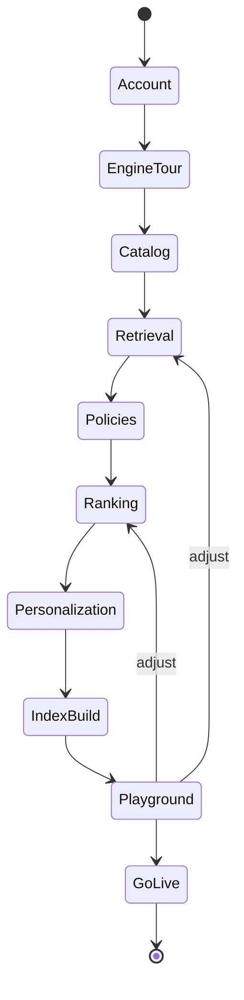
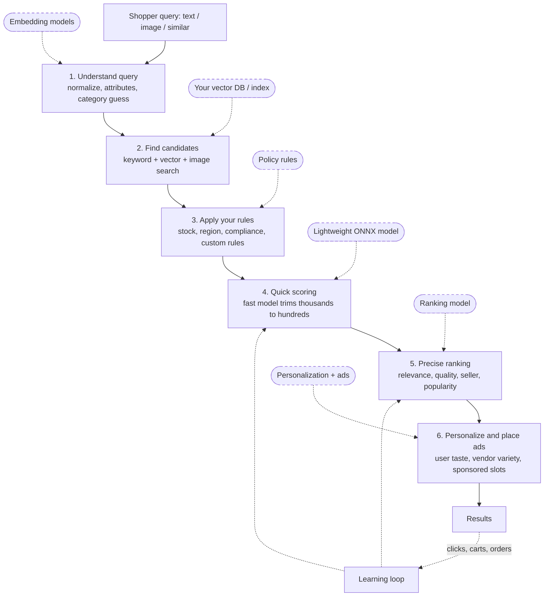

# ONBOARDING.md — Tenant Sign-up and Guided Setup

## 1. Goals

- A new tenant understands how the engine works before configuring it.
- Every step writes to the config draft and is validated server-side. The UI never holds config state that the server hasn't seen.
- Every step offers **Use platform default** as the primary path; BYO is opt-in.
- The tenant reaches a working search playground on platform defaults in ≤ 10 minutes.
- Progress is resumable. State lives in `onboarding_state`.

## 2. Wizard flow

Steps after `Catalog` can be skipped with **Use defaults for the rest**, which jumps to `IndexBuild`. A blocking validation error prevents advancing; warnings do not.

## 3. Engine explainer diagram (step 1, also persistent in the dashboard)

This diagram is rendered by `web/onboarding` as an interactive SVG component (`EngineDiagram`). Each stage is clickable and opens a side panel with:
- what the stage does;
- what the tenant can configure;
- the current choice (platform default or BYO);
- a link to the wizard step that configures it.

Data comes from `GET /v1/tenants/{tid}/engine-explainer`.

UI requirements:
- Injectable nodes are dashed and show a badge: `Default` or `Custom`.
- The diagram is mobile-first: a vertical layout under 768 px, with injection nodes collapsed into a chip row under each stage.
- Accessible: each stage is a `button` with `aria-expanded` controlling its panel, the full diagram is keyboard navigable, and a text-equivalent ordered list is provided for screen readers.

## 4. Steps

| # | Step | Tenant does | Server validation (`PUT /onboarding/steps/{step}`) |
|---|---|---|---|
| 0 | **Account** | Company name, slug, region, plan, owner email/password (sign-up) | Slug unique, password policy, email verification sent |
| 1 | **Engine tour** | Walks through the explainer; marks it done | None. Recorded for analytics only |
| 2 | **Catalog** | Chooses ingestion: event stream (Kafka topic or webhook), or batch upload (JSONL/CSV). Pastes a sample payload and maps fields with a JSONPath mapper. Preview shows the canonical product. | Mapping preview succeeds; required fields mapped (`product_id`, `title`, `category_path`, `price_minor`, `currency`, `vendor_id`, at least 1 `image_urls`) |
| 3 | **Retrieval** | Embedders: platform (`bge-small-en-v1.5`, `clip-vit-b32`) or BYO model (register endpoint, then validate). Stores: platform-hosted or BYO connection (type, endpoint, `secret_ref`, collection, vector names/dims/metric), then **Test connection**. Retriever mix uses presets: Balanced (default), Keyword-heavy, Semantic-heavy, Visual-first. | Models `validated`; connection test passes; embedder dim equals store dim; retrievers available for the chosen models |
| 4 | **Policies** | Toggles templated filters (in stock only, verified vendors only, ship-to region); adds custom CEL rules in an editor with **Test against sample products** | CEL compiles in the restricted env; cost estimate within limits; test results shown per rule |
| 5 | **Ranking** | Choose: Default (tunable weight sliders for the `default_linear` features), Platform learned model (available once enough events exist; disabled with an explanation before then), or BYO (upload ONNX pre-rank and/or register a remote rank model) | Weights within `[0, 5]`; models validated; feature schema resolvable |
| 6 | **Personalization & ads** | Personalization on/off plus strength; vendor diversity (max per vendor per 10 results); ads on/off, slot positions, relevance floor | Rules 11–12 from `docs/TENANT_CONFIG.md` §5 |
| 7 | **Index build** | Click **Publish & build** | Draft passes full validation, then publish (version 1), then start the index job; progress via `GET /index/jobs/{id}` (poll every 2 s, or SSE) |
| 8 | **Playground** | Text and image search against the new version, with an explain panel showing per-stage candidates, scores and fallbacks; side-by-side comparison with platform defaults | None |
| 9 | **Go live** | Activate the version, optionally with shadow mode first; create a production API key; copy the integration snippet | Version active; API key created |

### 4.1 Step API as implemented (M4)

Each step is `PUT /v1/tenants/{tid}/onboarding/steps/{step}` with a strict JSON body (unknown fields are rejected). A valid step edits the tenant's **draft** config, marks the step complete and returns `{step, next_step, warnings, data, state}`. An invalid step returns 422 with every field error and changes nothing. Steps unlock in order (409 when skipping ahead) and a completed step can be revisited. `?use_defaults=true` on any step from retrieval to personalization applies the platform defaults and completes all four.

| Step | Body | Notes |
|---|---|---|
| `engine_tour`, `playground` | `{}` | Recorded only |
| `catalog` | `{ingestion: "events"\|"upload", field_mapping, custom_fields?, samples}` | The mandatory catalog fields plus `vendor_id` and `image_urls` must be mapped; 1–20 samples must map without errors (same engine as `catalog/mapping/preview`) |
| `retrieval` | `{preset?: "balanced"\|"keyword"\|"semantic"\|"visual", embedders?, stores?}` | Presets set the retriever mix and weights. BYO embedders and vector stores reference models and connections registered and validated first (`POST /models` + `/validate`, `POST /connections` + `/test`); the step runs the live checks of `docs/TENANT_CONFIG.md` §5 rules 3–6. The lexical index stays platform-hosted |
| `policies` | `{in_stock?, ship_to_region?, verified_vendors?, rules?}` | Toggles become `policy.always_filters`. CEL `rules` are saved with a `deferred` warning; they are compiled and enforced from M7 |
| `ranking` | `{mode?: "default", weights?}` | `default_linear` with optional weight overrides. `learned` and `byo` return `not_available` until M7 |
| `personalization` | `{personalization?, diversity?, ads?}` | The config sections of the same names, with the range rules from `docs/TENANT_CONFIG.md` §5 |
| `index_build` | `{upload_id?}` | Publishes the draft (full validation) and queues an index job; `data` is `{version, job}`. Poll `GET /index/jobs/{id}` |
| `go_live` | `{version?, mode?: "activate"}` | Needs a verified email. Activates the version (default: the latest published) and, if the tenant has no API key yet, creates one; `data.api_key` is shown once. Shadow mode is started from the config API first |

## 5. Implementation notes (`web/onboarding`)

**Stack and structure**
- Next.js App Router, TypeScript strict, Tailwind CSS.
- Server Components for data loading; client components only for interactive pieces (diagram, mapper, CEL editor, sliders, upload).
- API access goes through a typed client generated from `api/openapi/control.yaml` (`openapi-typescript`).
- control-api returns a short-lived access token and sets the rotating refresh token as the `se_refresh` httpOnly cookie. The app keeps the access token server-side (httpOnly cookie) and calls the API from Route Handlers or Server Actions, so client JS never sees tokens.

**Routes**
- `/onboarding/[step]`, with a step guard that redirects to `current_step` if the tenant tries to skip ahead without completion.

**Reusable components**
`Stepper`, `EngineDiagram`, `StagePanel`, `ProviderChooser` (default vs. BYO), `ConnectionForm`, `ModelRegistrationForm`, `JsonPathMapper`, `CelEditor`, `WeightSliders`, `SlotPicker`, `IndexProgress`, `PlaygroundSearch`, `ExplainTrace`.

**Behavior**
- Forms are validated client-side for UX and server-side as authority; server `errors[].path` values map to fields.
- Accessibility: labels on all inputs; focus management on step change; the progress announcement is an `aria-live="polite"` region.

## 6. Acceptance test (M9)

A Playwright end-to-end test does the following:
1. Sign up a new tenant.
2. Complete the tour.
3. Upload the sample JSONL (100 products from `data/products.canonical.jsonl`) and map fields.
4. Keep the defaults.
5. Add one CEL filter.
6. Publish & build.
7. Run one text and one image search in the playground and assert results.
8. Activate the version.
